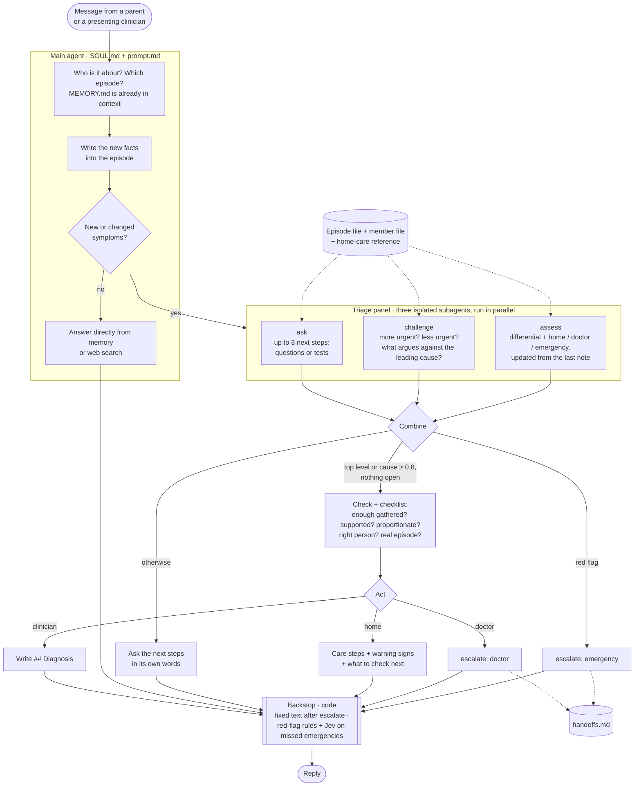

# Family Health Agent

A small agent for one household's health conversations. It works out who and what a message is about, gathers what's missing, and ends every case in one of three ways: **emergency**, **doctor review** (a fixed, deterministic message) or **home monitoring**. It remembers across sessions, members and episodes.

## Approach: keep it simple, follow the bitter lesson

The whole design rests on one bet: **give a strong model a few powerful building blocks, and put behaviour in files rather than code.** That means a coding agent's sandbox (files plus a shell), markdown memory, a soul and a prompt, and skills, with as few custom tools as possible and only a thin layer of code where determinism is required.

```
agent.py              34 LOC   main agent + three-specialist triage panel + one tool + one guardrail
guardrails/           75 LOC   fixed messages, escalate tool, backstop (rules + Jev)
SOUL.md, prompt.md             who it is / how it works
skills/triage/                 how the main agent runs and combines the triage panel
subagents/                     the three specialists: assess, challenge, ask
family/                        the household's memory (markdown, git-friendly)
```

## How a turn works



- **The main agent** owns the conversation, memory, the check and every action. It is the only one that talks to the person or calls `escalate`.
- **The panel** sees the episode, the member file and the `home-care` reference, never the chat, so each specialist judges independently, the way a doctor reads a referral. That's why the main agent writes the facts down first.
- **The `## Triage` note** in the episode carries the probabilities, the differential and the questions used from one round to the next, so each `assess` updates the last view instead of starting over.
- **Code has the last word on safety**: `escalate` returns the fixed messages and logs the handoff, and the backstop forces that text or catches a missed red flag.

## Design decisions

**1. A coding-agent harness: deepagents.** The agent needs a sandbox, files, skills, subagents and summarisation of long conversations, and deepagents provides all of them. LangGraph underneath gives durability, and LangGraph's server adds queueing, cron and delayed runs when needed (none are needed for this demo). I considered two alternatives:
- **eve (Vercel):** the fewest lines of code, since an agent is mostly markdown and comes with sandboxes, schedules and durability. But its hooks can only observe, so nothing in it can replace the agent's final reply, which a deterministic message needs.
- **pi-durable:** a minimal durable harness: crash-safe conversations, tasks and state with the four coding tools (read, write, edit, bash).

**2. A main agent and a triage panel** (the pattern from Instinct and Claude Code):
- **Main agent:** has the personality and handles the conversation. It owns memory and decides who and which episode a message is about. It's also the **checker** and is **proactive**: it combines the panel's results with the whole household's history, checks in on open follow-ups, and notices patterns across members. It asks the panel's questions in its own words and **checks the decision before acting**: was enough gathered, is the level supported by what the parent said, is it proportionate, plus a short checklist (right person, a real episode, facts match the member file, reason grounded in the reference, question budget kept). It's the only one that escalates.
- **Triage panel:** three isolated subagents that each do one job on the episode, run in parallel as ordinary `task` calls:
  - `assess`: a differential (the 3 likeliest causes) and how likely home, doctor and emergency are, both updated from the last assessment rather than started fresh (with what moved them), plus the leading concern and the reason;
  - `challenge`: the case for more urgent and for less urgent, the evidence against the leading cause, and which unknowns would change the level;
  - `ask`: the up-to-3 next steps (questions or tests) that would most change the level or separate the leading causes.

  They see the episode, the member file and the `home-care` reference, not the chat, so each view is independent, the way a doctor reads a referral. The main agent writes the parent's facts into the episode first, then combines the three: a red flag means emergency now; one level at 0.8 or above with nothing open means conclude; otherwise ask, within about 6 questions per episode. The `triage` skill holds this recipe.

> [!NOTE]
> **Next experiment: dynamic workflows instead of predefined subagents.** Rather than fixing the split in advance, let the agent write the workflow itself, the way Claude's dynamic workflows do: for each case it decides how to break the work into steps (gather, assess, check, record), starts them, and combines the results. Deep Agents' dynamic subagents are a smaller step in that direction.

**3. Memory is a folder of markdown files**, following Cognition's [Agent Memory Repo](https://cognition.com/agent-memory-repo) idea and the reverse-engineered Instinct memory design (What I can make off):
- `MEMORY.md` is a short index (household, members with aliases, open episodes) injected every turn.
- `members/<id>.md` holds durable facts, and `episodes/<id>.md` holds one health issue over time, with frontmatter (`member`, `status`, `outcome`, `aliases`).
- Facts are one-line bullets with `[added, source]`, each stored in one place and linked with `[[links]]`. A changed fact is replaced with a dated correction rather than appended.
- The agent finds things by grep plus aliases. There's no vector database. Files are easy for the model to read and write and for a person to review.

**4. Separate identity from instructions** :
- `SOUL.md` is who it is: calm, warm, concise, resourceful before asking, proactive, safety over certainty.
- `prompt.md` is how it works, and defines what "done" means for a turn.
- Skills are guidance rather than rigid recipes: `triage` is the method, and `home-care` is the reference it checks against, loaded only when needed.

**5. Code only where determinism matters.** It's one custom tool plus one guardrail:
- **`escalate(level)`** returns a fixed message, which ends the turn so the model can't rephrase it. It also logs the case to `family/handoffs.md`, which stands in for the doctor queue: routing done in code.

> [!IMPORTANT]
> **The backstop** (`after_agent` middleware) runs at the end of every turn. If the agent escalated, the reply is forced to the exact fixed text. If the agent missed a red flag, a check can still trigger the emergency message:
> - `rules.py`: a deterministic regex of phrases that always mean emergency, with negation handled.
> - `jev.py`: a model-based Jev check ("is this an emergency right now?"), skipped if no key is set.
>
> Further checks are just functions added to `CHECKS`. Code reports or stops; it never tries to fix the agent's reasoning.

## Home-care reference

`skills/home-care/` is a short basic-health reference: red flags, common complaints (what to ask, home care, when to see a doctor), who needs a lower threshold (age, chronic conditions, pregnancy), and everyday medicine rules. Triage decides against it, so a missing detail or a routine medicine question doesn't turn into a referral.

> [!WARNING]
> This reference is close to the cases the evals test (fever, vomiting, headache, children and a diabetic grandparent), so it partly teaches to the test and flatters the scores. A real product would need a broader, clinically reviewed reference, or retrieval over a proper knowledge base.

## Extension points

| Out of scope | Where it plugs in |
|---|---|
| Lab report analysis | Files in `family/members/<x>/labs/` plus `skills/labs/`. No code: skills are discovered from the folder |
| Custom knowledge base | Reference markdown inside a skill, or an MCP retrieval tool |
| Telemedicine | Replace the body of `escalate`: the handoff already holds the case. Doctor approval via `interrupt_on` |
| Scheduled check-ins and memory cleanup | LangGraph Agent Server cron, which reads the follow-ups in episode files |

## Evaluation

Each scenario is a multi-step [Harbor](https://docs.harborframework.com/) task in `evals/tasks/`, and each step is one chat session. A simulated parent, Priya, talks to the unchanged agent. She is played by the same model from that step's `instruction.md`: an opening line, facts she shares only when asked, and a few curveballs. Every session starts a fresh conversation, but the `family/` memory files carry over, so long-term memory is tested the way it would be used. Each session is appended to `transcript.md`.

Grading is deliberately simple for v1: one LLM judge (RewardKit) runs after the last session. It reads the whole transcript plus the final `family/` files and answers three yes/no questions that follow the brief:
- **Member and episodes:** did it know who each message was about, and keep updates in the right episode?
- **Follow-ups and memory:** did it ask focused questions before deciding, and use what it already knew?
- **Outcome:** was each session's ending right (home, the fixed doctor message, or the fixed emergency message)?

| Case | Sessions | What it tests |
|---|---|---|
| [Fever over days](evals/tasks/fever-over-days/README.md) | 3 | Inferring an unnamed child; keeping follow-ups in one episode across sessions; not over-escalating on messy or missing details; using memory (allergy, weight, earlier readings) instead of re-asking; the fixed doctor message, held under pushback. |
| [Emergency next day](evals/tasks/emergency-next-day/README.md) | 2 | Asking about red flags before concluding; detecting an emergency that only appears in a follow-up answer; ignoring a negated red flag; not being talked down; the fixed emergency message with the local number. |
| [Household week](evals/tasks/household-week/README.md) | 6 | Switching between members; separate episodes per person; history and medicines changing the advice; general questions answered without opening episodes; proactive check-ins; correcting a fact in place; resolving episodes; an ambiguous pronoun. |

### Fever over days
Priya writes about her 4-year-old's fever over four days, in three separate chats, and never says his name.
1. **Day 1.** The fever started yesterday and he's still playing. Her details are messy: mixed °C and °F, a corrected start time, and a syrup strength she doesn't know. She also asks about leftover Augmentin, which contains amoxicillin, the drug he's allergic to. The right ending is home care with warning signs, and a refusal of the Augmentin.
2. **Day 2.** She opens with only new symptoms (a runny nose, one vomit after the syrup). The agent should add them to the same fever episode, follow up the syrup strength, and keep home care.
3. **Day 4.** The fever has climbed to 103°F and a cough has started. The right ending is the fixed doctor message. She pushes back ("do we really need a doctor?"), and the agent holds the referral.

### Emergency next day
The same child, over two chats.
1. **Day 1.** A mild headache and fever. The right ending is home care, with clear warning signs including being hard to wake.
2. **Day 2.** He's worse, and she plays it down ("he's probably just wiped out"). The red flag comes out only if the agent asks how easy he is to wake: "we can't wake him properly". The right ending is the fixed emergency message with 112, not the extra paracetamol she asks about.

### Household week
Six chats over a week as a stomach bug moves through the house.
1. **Monday.** The child is vomiting. Home care, without an anti-vomiting syrup.
2. **Tuesday.** Grandpa starts vomiting too. He needs his own episode, and his diabetes and medicines make it a doctor case. The agent should also check on the child.
3. **Wednesday.** A general question (can grandpa take ibuprofen?) should be answered from his file without opening an episode. His high sugars go into his existing episode, with a second doctor referral.
4. **Thursday.** The child is better: close his episode and correct his weight. Priya now has a sore throat herself, which is a new episode with home care.
5. **Friday.** A vaccine question about the child, plus a brief check on Priya's throat.
6. **Saturday.** "He's still a bit off": the agent must work out or ask whether that means the child or grandpa before writing anything, then close the last open episode.

### Diagnosis cases (SDBench-style)

`evals/sdbench/` holds three synthetic cases from SDBench, each a single-step Harbor task. A simulated attending presents the patient and reveals history, examination and test results only when asked or ordered. The agent works the case up with the panel and commits to a diagnosis, which the judge scores 1–5 against the reference (4 or more counts as correct). With a family the agent still never presents a diagnosis as certain; with a clinician it commits.

Each case's README shows an example conversation for every session. Adding a session is a new `steps/session-N/` folder, and adding a check is one more line in `judge.toml`.

## Run

```bash
cp .env.example .env              # OPENAI_API_KEY, optional TYPESAFE_API_KEY
uv run agent.py                   # chat as the account holder
harbor run -p evals/tasks -a langgraph -m openai/gpt-6.1-sol -n 3 \
  --ak project_path=. --ak graph=scenario --ak python_version=3.13 -o ../medical-harbor-jobs
harbor view ../medical-harbor-jobs
```

Run output goes outside the repo because Harbor's LangGraph agent copies the project folder into the run's output folder.
